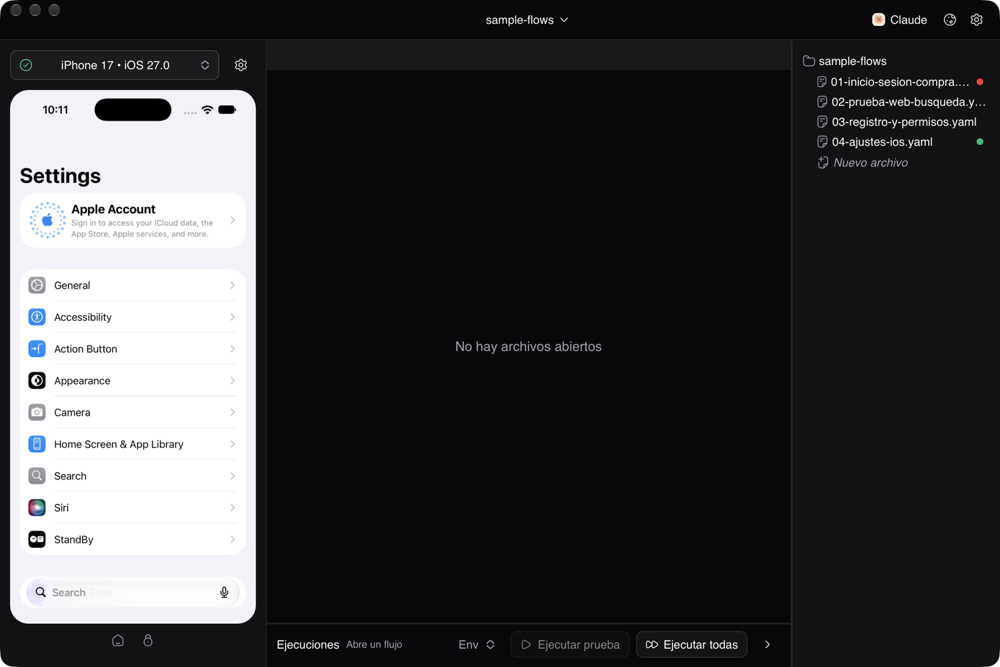
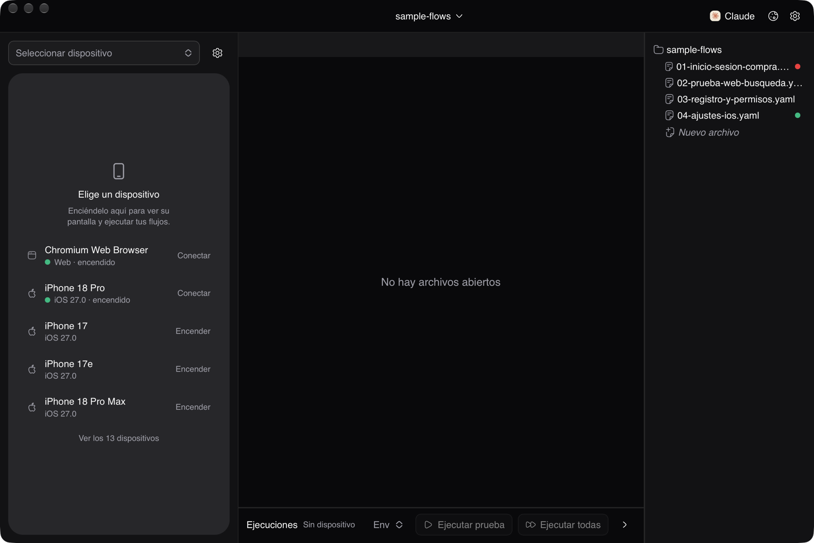
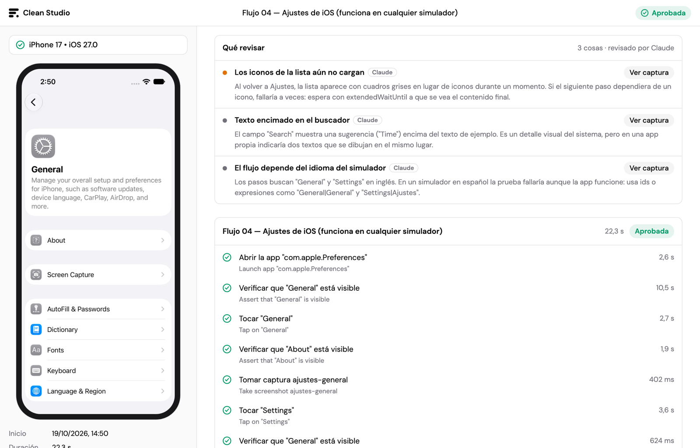
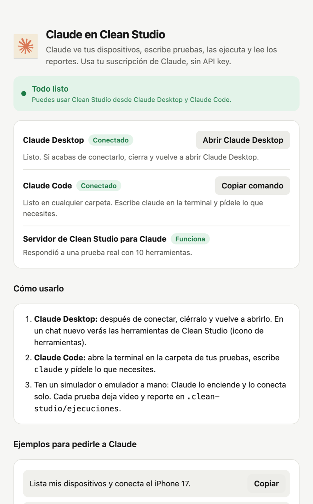

# Clean Studio (`clean-studio`)

**Automatización E2E móvil (Android / iOS) y web en español • Núcleo nativo en Rust (Tauri v2) + motores de Maestro • Sin cuentas • Cero telemetría**



| | |
|---|---|
|  |  |
| Sin dispositivo conectado, el panel lista los simuladores y emuladores para encenderlos con un clic. | Cada ejecución deja un reporte con video, pasos y **Qué revisar**: fallos, cierres, lentitud, parpadeos y la revisión de Claude. |

---

## Cómo funciona

1. **Interfaz** (`studio-ui/`, generada): `scripts/build-studio-ui.mjs` toma la interfaz de Maestro Studio 0.9.8 instalada en `/Applications`. Sobre ella:
   - la traduce al español (`translations_es.json`);
   - quita el inicio de sesión obligatorio de Maestro Cloud;
   - desactiva PostHog;
   - le inyecta `src/shim/electron-shim.js`.
2. **Shim de Electron** (`src/shim/electron-shim.js`): la interfaz espera ejecutarse en Electron. El shim le da `require("electron").ipcRenderer` y los módulos de Node que carga al arrancar, y manda cada canal IPC al backend Rust.
3. **Núcleo nativo** (`src-tauri/`): reemplaza el proceso principal de Electron.
   - `studio-server.jar` (puerto `5050`), con su JVM empaquetada.
   - `simulator-server`, el espejo en vivo de iOS y Android vía MJPEG.
   - Workspace y archivos: árbol, vigilancia de cambios, crear, renombrar, mover, duplicar y enviar a la Papelera.
   - Ajustes (Android SDK, editor), ventanas, menú nativo y diálogos de macOS.
4. **Cero telemetría**, en la interfaz y en el motor:
   - **Interfaz**: la CSP solo permite conexiones a `localhost`, así que Sentry y PostHog no pueden enviar nada.
   - **Motor**: `studio-server.jar` trae Sentry con el DSN fijo y la analítica de Maestro CLI. La JVM arranca con `MAESTRO_CLI_NO_ANALYTICS=1` y todo su HTTP(S) saliente va a un proxy local inexistente; solo localhost queda directo. Verificado con `lsof` durante una ejecución fallida: ninguna conexión externa.
   - Maestro Cloud, OAuth y las actualizaciones automáticas están deshabilitados.

---

## Funciones de Clean Studio

- **Evidencia de cada ejecución**: al terminar una prueba se crea `<workspace>/.clean-studio/ejecuciones/<fecha>-<flujo>/` con:
  - el **video** que grabó el motor;
  - las capturas (`takeScreenshot`);
  - `ejecucion.json`;
  - un **reporte HTML en español** listo para compartir.
  
  En el menú **Ejecuciones** puedes abrir el último reporte o la carpeta, decidir si se guarda el video y si el reporte se abre al terminar.
- **Qué revisar** (informe de calidad): arriba de cada reporte, del más grave al más leve:
  - **fallos**: el paso que falló de verdad, con su explicación;
  - **cierres y bloqueos** de la app (logcat en Android, reportes de cierre en iOS) y errores de JavaScript de React Native;
  - **pasos lentos**, comparados con ejecuciones anteriores del mismo paso;
  - **pruebas inestables**: con el mismo YAML, unas veces pasan y otras fallan;
  - **parpadeos**: destellos y zonas que se aclaran y oscurecen sin que la prueba toque nada, detectados en el video (`cuadros.swift` con AVFoundation, sin ffmpeg).

  Cada aviso salta a su momento en el video. Se calcula en tu Mac: no usa Claude.
- **Revisar con Claude**: el botón **Revisar** de la barra de ejecución saca una captura al final de cada paso y le pide a Claude Code, sin abrir ventanas, que anote lo que una regla no ve (textos con faltas, datos que no coinciden entre pantallas, elementos cortados o encimados). Los hallazgos aparecen en el reporte con la etiqueta *Claude* y su captura.
- **Arreglar con Claude**: debajo de cada paso fallido. Abre Claude Code en la carpeta de las pruebas con el error ya explicado para que lo diagnostique, corrija el flujo y lo vuelva a ejecutar.
- **Estado de cada flujo**: el árbol de archivos marca con un punto verde, rojo o ámbar el último resultado; al tocarlo se abre el reporte. La barra de ejecución dice por qué no se puede ejecutar (sin dispositivo, sin flujo abierto) o cómo terminó la última vez.
- **Aviso al terminar**: notificación de macOS con el resultado si Clean Studio no está al frente (`notificarAlTerminar: false` en la configuración para apagarla).
- **Errores en español**: cada paso y cada error del motor se muestran traducidos, con una explicación y cómo corregirlo. La tabla vive en `src/shim/errores_es.json` y la comparten la interfaz y los reportes.
- **Claude controla Clean Studio (MCP)**: el botón **Claude** de la cabecera (o el menú **Clean Studio → Conectar con Claude…**) abre una ventana que indica si ya funciona, conecta Claude Desktop y Claude Code con un clic y trae ejemplos para pedirle a Claude. Usa tu suscripción de Claude, sin API key. Herramientas:

  | Herramienta | Qué hace |
  |---|---|
  | `listar_dispositivos`, `conectar_dispositivo` | Ver y encender simuladores o emuladores |
  | `ver_pantalla` | Captura de la pantalla más la lista de elementos (texto, id, posición) |
  | `ejecutar_comandos` | Ejecutar pasos YAML sueltos al instante |
  | `validar_flujo`, `ejecutar_flujo` | Validar o ejecutar un flujo; deja video y reporte |
  | `ultimas_ejecuciones`, `leer_ejecucion` | Consultar la evidencia guardada |
  | `guardar_revision` | Guardar los hallazgos de una revisión visual en el reporte |
  | `guia_comandos` | Referencia de comandos YAML en español |

  `ejecutar_comandos` acepta `appId` para usar `launchApp`, `stopApp` o `clearState` sin crear un archivo.

  Para Claude Code:

  ```bash
  claude mcp add --scope user clean-studio -- "/Applications/Clean Studio.app/Contents/MacOS/clean-studio" mcp
  ```
- **¿Cuándo se usa Claude?** Ejecutar pruebas, el informe "Qué revisar", los reportes y los videos **no usan Claude**. Solo lo usan los botones **Revisar** y **Arreglar con Claude** (y lo que le pidas a Claude por MCP), con tu suscripción de Claude Code.

  
- **Sin nube ni cuentas**: no hay inicio de sesión, ni pestañas o avisos de Maestro Cloud, ni actualizaciones automáticas.

---

## Requisitos

- macOS con **Maestro Studio 0.9.8** instalado en `/Applications`, de donde se toman la interfaz y los motores (`MaestroStudio.dmg`).
- Node.js y Rust (cargo).
- Xcode (simuladores iOS) y/o Android SDK (emuladores). Al compilar, Xcode también construye el detector de parpadeos; sin Xcode la app funciona igual, sin esa parte.

---

## Comandos

```bash
# Prepara studio-ui/ y engines-bundle/ (lo ejecutan también los comandos de Tauri)
npm run studio-ui

# Desarrollo con ventana nativa
npm run tauri:dev

# Compilar la app (.app / .dmg, incluye JVM + studio-server + simulator-server)
npm run tauri:build
```

Para abrir directamente una carpeta como workspace:

```bash
"Clean Studio.app/Contents/MacOS/clean-studio" ~/ruta/a/mis-flujos
```

---

## Estructura

- `scripts/build-studio-ui.mjs`: extrae, traduce y parchea la interfaz, y prepara `engines-bundle/`.
- `src/shim/electron-shim.js`: emulación de Electron dentro del webview.
- `src/shim/errores_es.json`: traducciones de pasos y errores del motor.
- `src-tauri/src/`:
  - `ipc.rs`: despacho de canales.
  - `server.rs` y `simulator.rs`: los motores.
  - `runs.rs`, `reports.rs` y `errors.rs`: evidencia, reportes y traductor.
  - `calidad.rs`, `parpadeos.rs` y `cuadros.swift`: el informe "Qué revisar" y el detector de parpadeos.
  - `revision.rs`: "Revisar con Claude".
  - `mcp.rs` y `claude.rs`: servidor MCP y conexión con Claude Desktop y Claude Code.
  - `workspace.rs`, `settings.rs` y `windows.rs`.
  - `bridge.rs` y `paths.rs`: utilidades compartidas.
- `sample-flows/`: flujos YAML de ejemplo en español.
- `plantillas/`: flujos para las pantallas que casi toda app tiene (inicio de sesión, registro, recuperar contraseña, pago de prueba), con lo aprendido al probar apps reales. Ver [`plantillas/README.md`](plantillas/README.md).
- `docs/capturas/`: las imágenes de este README.
- `legacy/`: la interfaz React anterior, como referencia.
- `build_real_clean_studio.py`: variante que reempaqueta la app Electron original traducida.
